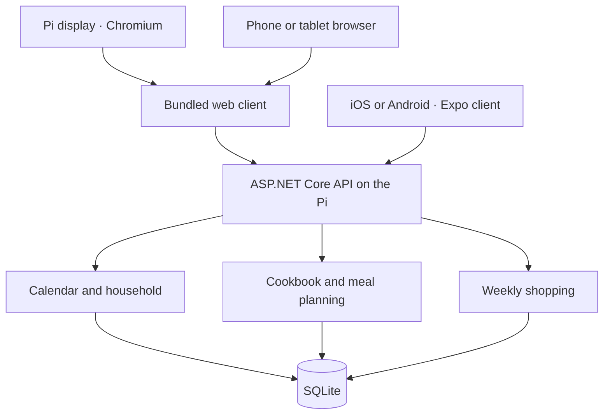

# Kitchen Table architecture

One ASP.NET Core 10 process owns the household's data, exposes a JSON API and serves the exported React Native Web client. This keeps a Pi deployment to one service and one SQLite database. The native app uses the same screens and API. SQLite transactions cover operations across recipes, meals and shopping without introducing a second service to coordinate them.



## Feature boundaries

| Feature and source | Owns | Connects to |
| --- | --- | --- |
| Calendar, `Calendar.cs` | Household profiles, colours, appointments, chores, start and end times | Optional person on an entry. Chore completion is an explicit state change. |
| Cookbook, `Recipes.cs` | Titles, base servings, ordered ingredients and cooking steps | The universal client can turn pasted text into an editable recipe. The API validates every saved recipe. |
| Meal planning, `Planning.cs` | Recipe, planned servings, day and slot | Each plan references a persisted recipe. The week planner shows meals alongside the day's events. |
| Shopping, `Shopping.cs` | Grouped ingredient totals, checked quantities and manual extras | A read projection combines the current recipes and planned meals for one week. |

`Program.cs` maps requests to the features. A `Database` opens a connection and a transaction for each operation and passes a `Session` into the feature. SQL stays close to its use. There is one deployment unit. Feature code and validation can be tested through ordinary HTTP against the same SQLite provider used on the Pi.

## Storage and calendar semantics

| Table | Important fields and relationships |
| --- | --- |
| `people` | Name, colour and edit version. One person can have many calendar entries. A null assignee displays as Everyone. |
| `entries` | Civil date, event or chore, optional start and end, optional person, completion and edit version. |
| `recipes` | Base servings and ordered JSON arrays for ingredients and steps. Each ingredient has a name, optional decimal amount and unit. Each recipe is edited as one document. |
| `meals` | Required recipe, planned servings, civil date and slot. A unique index enforces one Breakfast, Lunch, Dinner or Snack per day. |
| `shopping_checks` | Week and a deterministic ingredient-and-quantity key. Rows represent checked items. |
| `extras` | Manual shopping items with an independent ID, week and checked state. |
| `schema_versions` | Ordered migrations already applied. Startup runs pending migrations in a transaction and rejects a newer unknown schema. |

Weeks start on Monday and use a half-open interval through the following Monday. The Pi calculates today in `KitchenTable__TimeZone`, defaulting to `Europe/London`. Dates travel as `YYYY-MM-DD` and wall times as `HH:mm`. Blank times represent an all-day entry. This preserves an appointment at 09:00 on the kitchen display when a phone uses a different device time zone. Overnight events, recurrence and exact UTC instants require a richer event model.

## From recipe to shopping list

For each meal, scale each numeric ingredient by **planned servings ÷ recipe servings**. Sum matching names and units across the week after trimming, case-folding and collapsing whitespace. Display the first ingredient's spelling. Measured and unmeasured entries form distinct groups. Totals use decimal arithmetic and round once to six decimal places. For example, a 200 g ingredient in a four-serving recipe contributes 100 g for a two-serving lunch and 300 g for a six-serving dinner. The shopping list shows a single 400 g line.

Grams and kilograms remain separate until a unit-conversion policy is introduced. A blank quantity allows entries such as “salt to taste”. Imported ambiguous quantities stay as text for the cook to review. Changes to the recipe affect every meal that references it. A check represents one exact total for that week, so a changed amount appears unchecked unless that same total was already bought. Manual extras survive meal changes. This projection works without a job queue or rebuilding stored list rows.

## HTTP contract

JSON uses camelCase. Each edit request carries `X-Kitchen-Table: 1`. The deployed browser uses its own origin. A single explicit development web origin can use CORS. Native clients supply the API origin at build time.

| Method | Path under `/api` | Result |
| --- | --- | --- |
| GET | `/health` | Service readiness after successful migration |
| GET | `/week` or `/week?start=2026-11-23` | One consistent snapshot with start, today, timeZone, people, recipes, entries, meals and shopping |
| PUT | `/people/{id}` | Create or edit a name and colour |
| PUT | `/recipes/{id}` | Save a complete recipe and its ordered ingredients and steps |
| PUT | `/entries/{id}` | Save an event or chore, optional person and times |
| PATCH | `/entries/{id}/done` | Set a chore's checked state using `{"done":true}` or `false` in the same field |
| PUT | `/meals/{id}` | Save the recipe, date, meal slot and planned servings |
| DELETE | `/{people,recipes,entries,meals}/{id}?version=N` | Remove the selected entity at its current version |
| PUT | `/shopping/{week}/extras/{id}` | Add a manual item with `{"label":"Milk"}` |
| DELETE | `/shopping/{week}/extras/{id}` | Remove that manual item |
| PATCH | `/shopping/{week}/{itemId}/done` | Set the displayed shopping row's checked state |

Example meal creation using the included starter recipe and a caller-generated UUID.

```http
PUT /api/meals/8a7938e068754abc9c73a451088ba56c
Content-Type: application/json
X-Kitchen-Table: 1

{"day":"2026-11-24","slot":"Dinner","recipeId":"e67d700b33254ba4855344392c7bc3c4","servings":6,"version":0}
```

Writes return HTTP 204. Read the week again to obtain current versions and the recalculated list. Invalid content returns 400. Conflicting changes, occupied slots and referenced items return 409 with a problem-details message. A stale edit stays open in the UI so the user can review it.

## Concurrency and device refresh

- The client assigns an ID once when opening a create form. Version 0 creates the record. Updates and deletes include the version the user saw. A reserved SQLite writer transaction checks the version and updates it together. A repeated create cannot insert a second copy with that ID.
- Chore and shopping requests set the desired checked state. Repeating the same request leaves the state consistent. The meal slot constraint also handles two devices planning the same slot concurrently.
- A week loads in one read transaction with WAL enabled. The API returns a coherent calendar, meal plan and shopping list to the client. The UI refreshes after writes, on return to the foreground and every 15 seconds. Superseded reads cannot replace a newer result.
- The browser and native client keep presentation state in memory. A connection failure leaves an explicit error and any unsaved form visible. Household profiles are display labels. The initial access model grants the same permissions to every device on the home network.

## Extension points

| Later capability | Where it fits |
| --- | --- |
| Recipe websites or social sharing | Map permitted import sources to the existing recipe draft. Preserve source attribution, display the draft for correction, then use the existing save API. The text importer demonstrates this flow. |
| Shared calendar feeds | Add a source and external UID to imported events. Model recurrence exceptions, date-only events and time zones before adding a scheduled importer. |
| Large cookbooks | Split recipe summaries from full recipe detail. The starter sends the small household catalogue with each snapshot. |
| Accounts or remote access | Introduce authentication, per-household authorisation and HTTPS at the API boundary before making a release available outside the home. |

## Design references

The recipe-to-plan-to-list workflow draws on ReciMe. The wall display, family colours and shared tasks draw on Skylight Calendar. [ReciMe](https://www.recime.app/) · [Skylight Calendar](https://myskylight.com/en-gb/calendar/)

The client uses Expo's universal web approach. The deployment uses Microsoft's self-contained Linux ARM64 target and the Pi desktop kiosk pattern. [Expo web](https://docs.expo.dev/workflow/web/) · [.NET ARM deployment](https://learn.microsoft.com/en-us/dotnet/iot/deployment) · [Raspberry Pi kiosk guide](https://www.raspberrypi.com/tutorials/how-to-use-a-raspberry-pi-in-kiosk-mode/)
